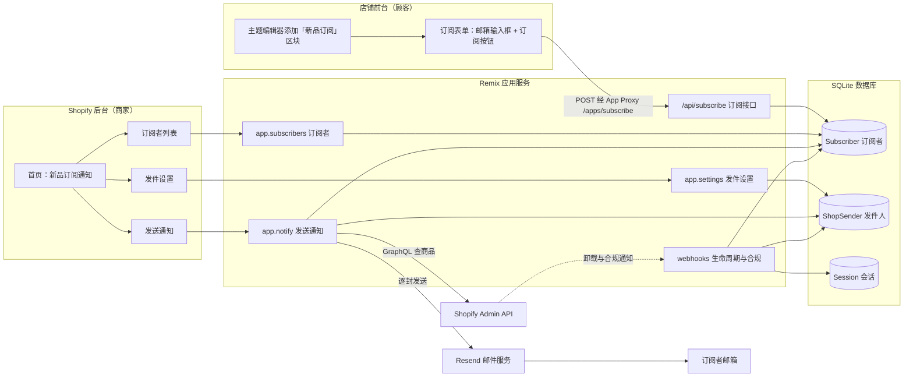
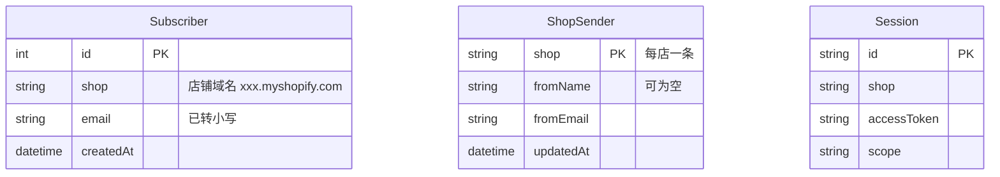
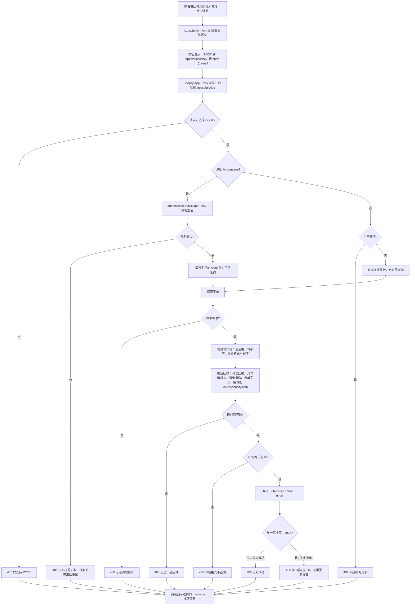
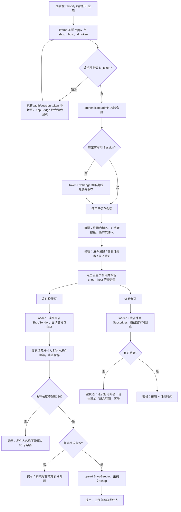
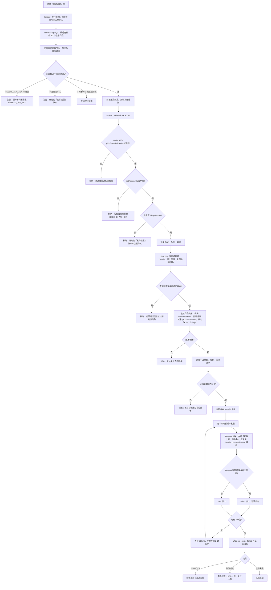
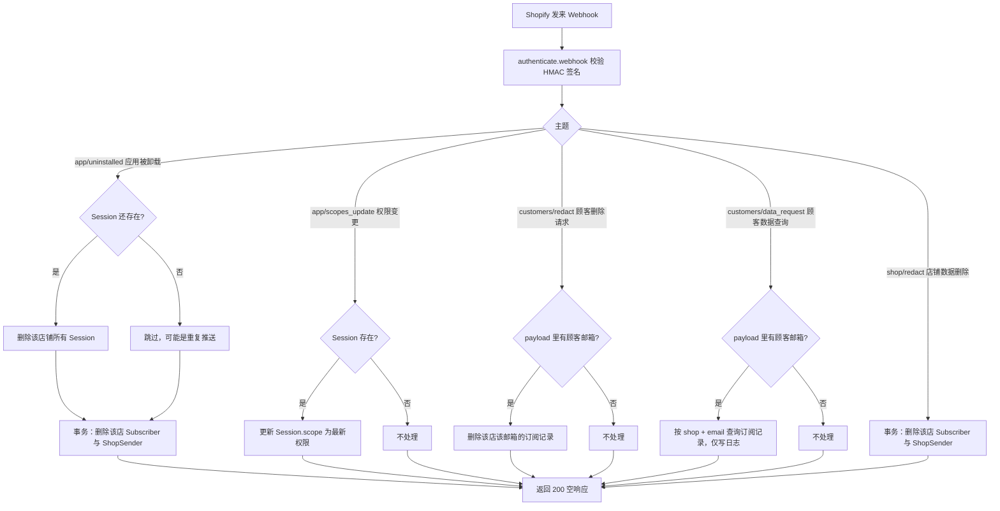

# 新品订阅通知（product-notify）功能与流程文档

## 1. 项目简介

一个 Shopify 嵌入式应用：

- 顾客在店铺前台用邮箱订阅「新品通知」。
- 商家在 Shopify 后台选择一个在售商品，一键给本店所有订阅者发送新品邮件。
- 每家店铺使用自己的发件人，订阅者与发件人数据按店铺隔离。

技术栈：Remix、Polaris 12、App Bridge 4、Prisma（SQLite）、Resend（发邮件）、React Email（邮件模板）、主题应用扩展（前台订阅区块）、App Proxy（前台到应用的通道）。

## 2. 功能清单

| 角色 | 功能 | 入口 |
| --- | --- | --- |
| 顾客 | 在店铺页面提交邮箱订阅 | 主题区块「新品订阅」 |
| 商家 | 查看首页概览：店铺、订阅者数量、当前发件人 | 后台 `/app` |
| 商家 | 查看订阅者列表（邮箱、订阅时间） | `/app/subscribers` |
| 商家 | 设置本店发件人名称和发件邮箱 | `/app/settings` |
| 商家 | 选择商品并给全部订阅者发送新品通知 | `/app/notify` |
| 系统 | 响应卸载、权限变更、合规数据请求并清理数据 | `/webhooks/*` |

## 3. 系统架构



## 4. 数据模型



- `Subscriber` 对 `(shop, email)` 有唯一约束，同一店铺同一邮箱不会重复。
- `ShopSender` 以 `shop` 为主键，一家店只有一个发件人。
- `Session` 由 Shopify 应用框架管理，保存登录会话与访问令牌。
- 三张表之间没有外键，靠 `shop` 字段关联。

## 5. 路由与文件对照

| 路径 | 文件 | 说明 |
| --- | --- | --- |
| `/app` | `app/routes/app._index.tsx` | 首页，三个入口按钮 |
| `/app/subscribers` | `app/routes/app.subscribers.tsx` | 订阅者列表 |
| `/app/settings` | `app/routes/app.settings.tsx` | 发件设置 |
| `/app/notify` | `app/routes/app.notify.tsx` | 发送通知 |
| `/api/subscribe` | `app/routes/api.subscribe.tsx` | 前台订阅接口，经 App Proxy 访问 |
| `/webhooks/app/uninstalled` | `app/routes/webhooks.app.uninstalled.tsx` | 应用被卸载 |
| `/webhooks/app/scopes_update` | `app/routes/webhooks.app.scopes_update.tsx` | 权限变更 |
| `/webhooks/customers/data_request` | `app/routes/webhooks.customers.data_request.tsx` | 顾客数据查询 |
| `/webhooks/customers/redact` | `app/routes/webhooks.customers.redact.tsx` | 顾客数据删除 |
| `/webhooks/shop/redact` | `app/routes/webhooks.shop.redact.tsx` | 店铺数据删除 |
| `/auth/*` | `app/routes/auth.$.tsx`、`app/routes/auth.login/` | 登录与授权 |
| 前台区块 | `extensions/subscription-form/` | 订阅表单（Liquid、JS、CSS） |
| 邮件模板 | `app/emails/NewProductNotification.tsx` | 新品通知邮件 |

## 6. 流程图

### 6.1 顾客订阅



要点：

- 生产环境必须带 App Proxy 签名，否则直接 401。
- 店铺以签名里的 `shop` 为准，表单里的 `shop` 只作为兜底，防止顾客伪造别家店铺。
- 重复订阅也返回成功，对顾客无感。

### 6.2 商家进入应用、发件设置、订阅者列表



要点：

- 首页三个按钮用整页跳转并保留 `shop`、`host`、`id_token` 等查询参数。如果用客户端路由跳转会丢掉这些参数，页面会被重定向到登录页，看起来像按钮没反应。
- 发件邮箱必须属于当前 Resend 账号里已验证的域名，否则发信会被 Resend 拒绝。

### 6.3 发送新品通知



邮件内容（`NewProductNotification`）：

- 商品主图（有则显示）
- 商品标题
- 「您好！您订阅的店铺 xxx 上新了：」
- 按钮「查看商品详情」，链接到商品页

### 6.4 生命周期与合规 Webhook



## 7. 配置说明

### 7.1 环境变量

| 变量 | 来源 | 说明 |
| --- | --- | --- |
| `SHOPIFY_API_KEY`、`SHOPIFY_API_SECRET`、`SCOPES`、`SHOPIFY_APP_URL` | `shopify app dev` 自动写入 | 应用身份与地址 |
| `RESEND_API_KEY` | 手动填写，在 https://resend.com/api-keys 创建 | 缺失时发送通知会被拒绝 |

发件名称和邮箱不放在环境变量里，由各店铺在「发件设置」里单独保存。

### 7.2 `shopify.app.toml`

- 权限：`read_products`、`write_app_proxy`。
- App Proxy：`/api/subscribe`，前台路径为 `/apps/subscribe`（`prefix = "apps"`，`subpath = "subscribe"`）。
- 前台区块里「订阅接口路径」默认 `/apps/subscribe`，需与上面的 prefix、subpath 保持一致。
- Webhook：`app/uninstalled`、`app/scopes_update`，以及三个合规主题 `customers/data_request`、`customers/redact`、`shop/redact`。

### 7.3 Resend 发件域名

- 发件邮箱必须是当前 Resend 账号里已验证域名下的邮箱，例如域名 `example.com` 验证通过后，可以用 `notify@example.com`。
- Resend 给域名生成的 `send`、`rsend` 之类子域名是退信与 SPF 用的，不能当作发件地址。
- DMARC 未生效不影响发信，但建议配置。

### 7.4 本地开发

```bash
pnpm install
pnpm dev          # 即 shopify app dev，会启动隧道、Vite 与代理
```

- 数据库为 SQLite（`prisma/dev.sqlite`），首次启动会自动应用迁移。
- `shopify app dev` 默认使用 Cloudflare 临时隧道，每次重启地址都会变，重启后需要在 Shopify 后台刷新应用页面。
- 开发预览的地址由 CLI 自动更新到应用配置里，无需手动修改 `shopify.app.toml`。

## 8. 已知限制

- 发送是同步循环，每封间隔 600ms。订阅者很多时，发送页需要保持打开，没有后台队列、断点续发或重试。
- 发送页只列出最近更新的 50 个在售商品。
- 没有退订功能，邮件中也没有退订链接。
- 没有「发送记录」，发送结果只在当次页面提示，失败的详情只写在服务端日志里。
- `customers/data_request` 只记录日志，不会向顾客返回数据。
- 数据库是 SQLite，适合开发和小规模使用，上线到多实例环境前需要换成托管数据库。
